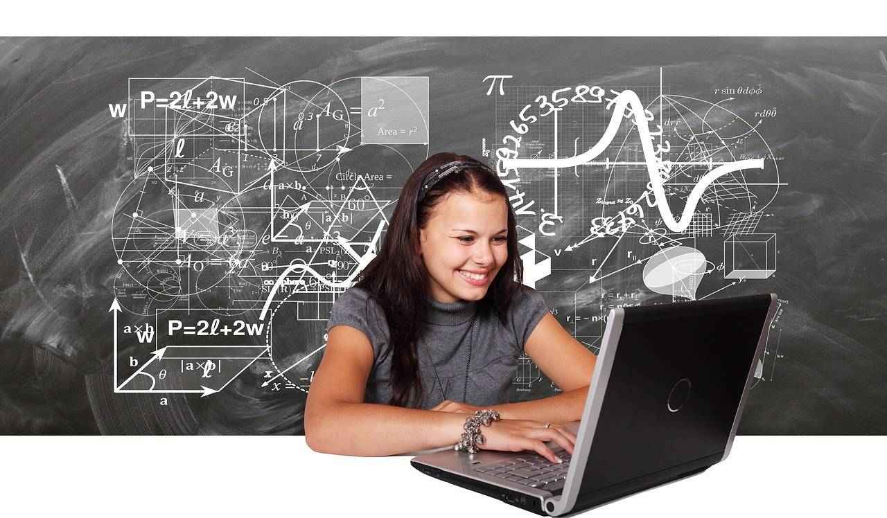

# Automated Power Generation Control for Two-Area Systems: How to Measure the Power Shared Between Two Areas in Case of Abrupt Load Changes (Simulation)

[Automatic Power Generation Control in Two Regions Systems]How to measure the power shared between two regions under sudden load changes (Simulink)

## Images

<!-- PAYMENT_BLOCK -->

## Get this dataset

- Payment link (Stripe): [Buy now](https://buy.stripe.com/3cs8yP7sY87d0vu9AB)
- Payment QR code: 

<!-- /PAYMENT_BLOCK -->
